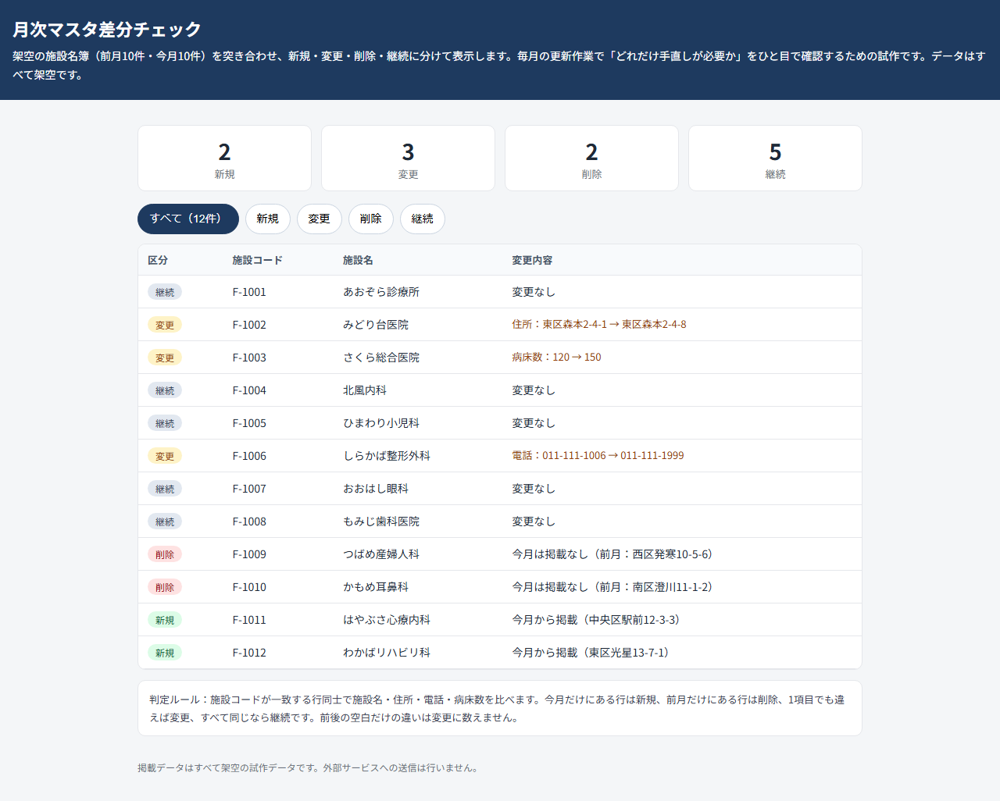
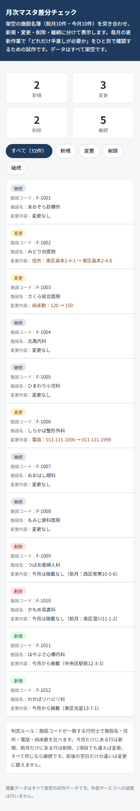

# 月次マスタ差分チェック POC

毎月更新される施設名簿のメンテナンス作業のうち、前月分と今月分の突き合わせ（新規・変更・削除・継続の分類）だけを試作したものです。データはすべて架空です。

## このPOCで確かめたこと

- 前月10件・今月10件の架空名簿を施設コードで突き合わせ、新規2件・変更3件・削除2件・継続5件に分けて表示できる
- 住所が変わった行を住所変更として一覧に含められる（テストで前後の住所を確認済み）
- 病床数が変わった行を病床数変更として一覧に含められる
- 前後の空白だけの違いは変更に数えない
- 画面を開いた直後に件数カードと12件の一覧が見え、区分ボタンで絞り込める

## 作っていない範囲

- Excel（.xlsx）ファイルの直接読み書き
- データベースへの取り込み・更新処理
- 住所ゆれの名寄せや重複判定
- AIによる要約・分類・文章生成（使っていない）

## 次の進め方

- 実際の更新ファイル形式（CSVかExcelか）に合わせて読み込み部分を追加する
- 変更行だけを抜き出した作業用リスト（CSV出力）を足す
- 件数が多い場合のページ送りや検索を追加する

## 動かし方

画面だけの試作のため、サーバは不要です。

1. `docs/index.html` をブラウザで開く
2. テストは `npm test` で実行する

